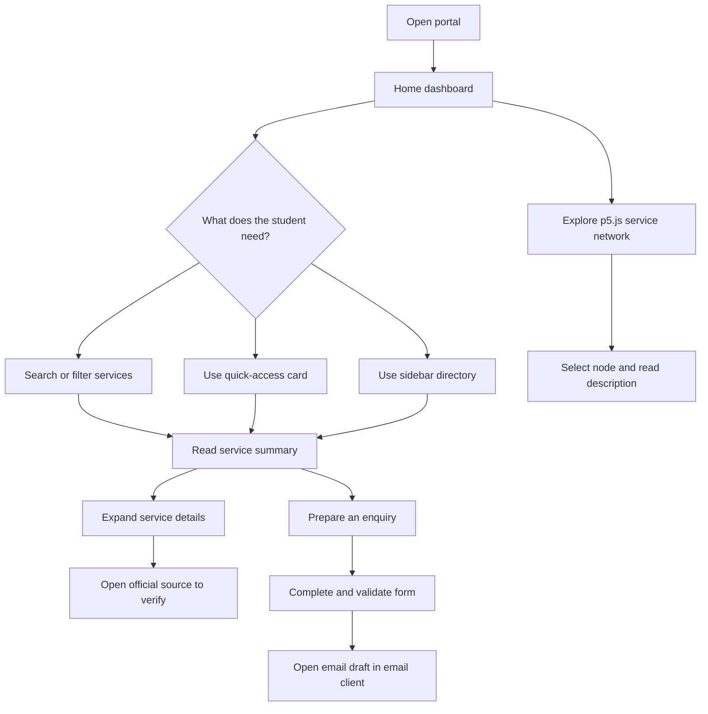

# User flow — MSUAS Student Services Portal

## Primary path
Home → Search/filter → Service summary → Expand details → Verify official page or prepare an enquiry.

## Alternative paths
- Quick-access card → category-filtered service cards.
- Sidebar directory → matching service card.
- Campus services network → select node → read service-area explanation.
